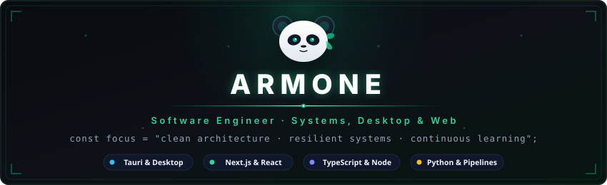

  <!-- Minimalist Panda & Emerald Modern Header Banner -->
  

  <!-- Animated Typing Subtitle (Emerald Glow) -->
  

  

    
    
  

---

### 🐼 Engineering & Philosophy

Software engineer specializing in desktop runtimes, high-throughput automation pipelines, and reactive web applications. Focused on engineering resilient architectures with clean system boundaries, minimal bloat, and high-fidelity user experiences.

* 🔭 **Active Focus**: Contributing to **[Readest](https://github.com/readest/readest)** (Tauri & Next.js desktop reading platform).
* ⚙️ **Core Stack**: TypeScript, Python, Tauri, Next.js, and modern web & desktop runtimes.
* 🌿 **Principles**: Minimalist design, sustainable code quality, and calm, disciplined execution.

---

### 📂 Featured Works

| Project | Tech Stack | Overview |
| :--- | :--- | :--- |
| **[Readest](https://github.com/readest/readest)** | `Tauri` `Next.js` `TypeScript` | Open-source cross-platform desktop reader with custom archive bundles and audio engines. |
| **[Price Radar](https://github.com/Armone0/price-radar)** | `Python` `Automation` `Telemetry` | High-frequency price tracking, scraping pipelines, and multi-channel telemetry bots. |
| **[Obsidian Readest Sync](https://github.com/Armone0/obsidian-readest-sync)** | `TypeScript` `Obsidian API` | Bi-directional synchronization bridge between reading applications and local markdown vaults. |

---

### ⚡ Arsenal & Technologies

  <!-- SkillIcons: Curated Brand Badges -->
  

 

| Domain | Stack |
| :--- | :--- |
| **Languages** | `TypeScript` · `JavaScript` · `Python` · `Java` |
| **Frontend & Desktop** | `React` · `Next.js` · `Tailwind CSS` · `Tauri` |
| **Environment & Tools** | `Node.js` · `Git` · `VS Code` |

---

### 📊 Telemetry & GitHub Metrics

  <table border="0">
    <tr>
      <td width="50%" align="center">
        
      </td>
      <td width="50%" align="center">
        
      </td>
    </tr>
  </table>

   

  

