 

### 🐼 About

I build **fast, private desktop tools for Windows**, plus the occasional systems project in Rust. Small footprint, no telemetry, clean boundaries.

- 🚀 **Now** · shipping [VortexDownloader](https://github.com/Armone0/VortexDownloader), an open-source download manager
- 📖 **Also** · contributing to [Readest](https://github.com/readest/readest), a Tauri + Next.js e-book reader
- 🌿 **Principles** · minimal bloat, local-first, calm and steady execution

### 📂 Featured Projects

### ⚡ Stack

 

🎋 Thanks for stopping by.

